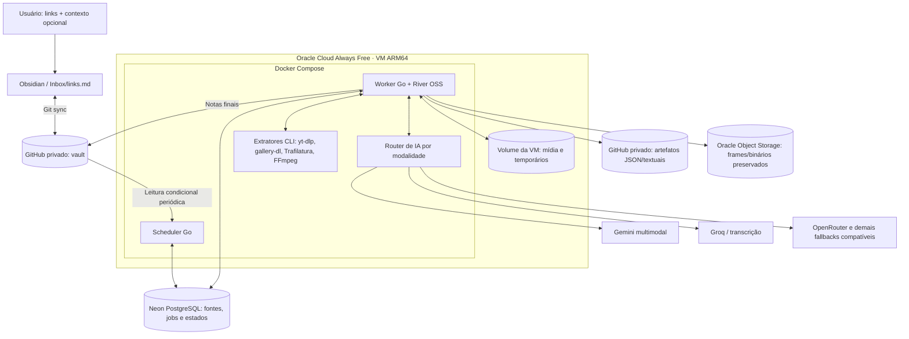
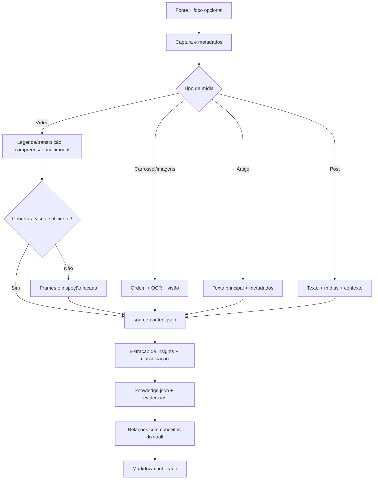

> **Projeto:** Noema | versão de arquitetura 1.2 (documento de referência)
> **Repositórios:** [core](https://github.com/CesarBraz7/noema), [artefatos](https://github.com/CesarBraz7/noema-artifacts), [vault](https://github.com/CesarBraz7/obsidian-vault).

# Noema — Especificação de Produto e Arquitetura Técnica

> **Versão:** 1.2 — proposta consolidada para implementação  
> **Data de referência:** 19 de novembro de 2026  
> **Status:** ingestão de artigos validada no Windows. Desenvolvimento local em andamento. Hospedagem contínua a definir.\
> **Idioma dos artefatos finais:** português brasileiro, preservando termos originais e citações quando necessário

---

## 1. Resumo executivo

O projeto **Noema** é uma plataforma pessoal, automatizada e extensível de **ingestão de fontes, extração de evidências, interpretação multimodal, classificação e consolidação de conhecimento**. O objetivo não é resumir indiscriminadamente cada link, mas **transformar materiais externos em conhecimento consultável, contextualizado, rastreável e interligado no Obsidian**.

O usuário salva uma URL — opcionalmente acompanhada de uma observação — em uma nota de inbox no Obsidian. O worker identifica a entrada, obtém o conteúdo por ferramentas open source, interpreta texto/áudio/imagens conforme a fonte, produz arquivos estruturados (`source-content.json`, análises e `knowledge.json`), gera notas Markdown e publica o resultado em um vault sincronizado por Git.

O projeto prioriza **custo zero quando possível**, aproveitando APIs gratuitas de IA antes de serviços pagos. O worker pode rodar no computador de desenvolvimento ou passar para outro host. Arquivos intermediários caros de produzir ficam preservados fora da máquina executora, possibilitando recuperação e reanálise seletiva.

**Princípios inegociáveis:**

1. **Extractor first:** ferramentas open source especializadas, em vez de navegador automatizado por padrão.
2. **Capturar uma vez, reutilizar várias:** transcrições, análises e resultados com checkpoints verificáveis.
3. **Evidência antes de síntese:** diferenciar o que a fonte diz, o que a IA infere e o que já está no vault.
4. **Portabilidade:** aplicação conteinerizada, banco e armazenamento desacoplados da VM.
5. **Gratuito primeiro:** fallback por capacidade, espera por cota e cobrança desabilitada até autorização explícita.
6. **Preservação da autoria:** não sobrescrever notas pessoais nem criar relações sem lastro.
7. **Baixo volume, sem urgência:** simplicidade e economia são mais importantes que latência ou escalabilidade precoce.

## 2. Objetivos e limites

### 2.1 Objetivos funcionais

- Receber links do YouTube, Instagram (Reels e carrosséis), X (posts, threads e vídeos), artigos e páginas web, além de arquivos MP4 quando disponibilizados por um canal de upload.
- Aceitar uma nota contextual opcional, por exemplo: “quero entender os trade-offs apresentados”; **a nota orienta a consolidação, mas não deve suprimir outros aprendizados importantes**.
- Reconhecer automaticamente o tipo de fonte e selecionar o extrator apropriado.
- Preservar mídia, texto, legendas, transcrição, timestamps, slides, diagramas, códigos e metadados relevantes, respeitando o que foi efetivamente capturado.
- Produzir uma nota por **fonte** e notas por **conceito**, reunindo conhecimentos de materiais diferentes.
- Permitir reprocessar somente etapas impactadas por mudanças de prompt, modelo, parser ou template.
- Operar continuamente na nuvem, com fila durável e retomada após falhas, sem depender do notebook ligado.
- Permitir adicionar links de forma simples pelo editor do Obsidian.

### 2.2 Não objetivos da primeira versão

- Chat RAG, embeddings, busca semântica avançada ou agente conversacional sobre todo o vault.
- Interface web própria, aplicativo móvel próprio ou múltiplos usuários.
- Captura irrestrita de conteúdos privados/restritos ou contorno de autenticação/anti-bot.
- Preservar todos os MP4s permanentemente.
- Rodar modelos multimodais pesados localmente na VM.
- Garantir análise literal de cada frame de todos os vídeos.
- Garantia de disponibilidade 24/7 ou de que provedores gratuitos jamais mudarão suas cotas.

## 3. Decisão de stack: Go no lugar de Node.js/TypeScript

### 3.1 Motivação

A primeira proposta usava Node.js/TypeScript por familiaridade do ecossistema com APIs, JSON e `pg-boss`. **A decisão consolidada passa a ser Go como orquestrador principal** porque entrega binário compilado, runtime enxuto, concorrência simples com goroutines, suporte excelente a HTTP, execução de processos externos e portabilidade Linux ARM64/AMD64.

A diferença de desempenho **não acelera substancialmente o trabalho pesado**, realizado por FFmpeg, downloaders e APIs de IA. A vantagem de Go aqui é principalmente eficiência operacional e previsibilidade de deploy.

| Papel | Escolha |
|---|---|
| API/worker/orquestração | Go |
| Banco e driver | PostgreSQL externo + `pgx` |
| Fila de jobs | River **open source** |
| Máquina de estados por fonte | Código Go + tabelas PostgreSQL |
| Rotinas Python preexistentes | `yt-dlp`, `gallery-dl`, `Instaloader` quando útil, `trafilatura` |
| Manipulação de vídeo/áudio | FFmpeg / ffprobe |
| OCR leve opcional | Tesseract inicialmente; outros motores mediante teste |
| Infraestrutura de execução | Docker Compose no Windows durante o desenvolvimento, com suporte a hosts Linux AMD64 e ARM64 |
| Artefatos textuais | GitHub privado separado do vault |
| Binários preservados | Oracle Object Storage |
| Editor de conhecimento | Obsidian gratuito + Git |

**Implicação de migração da stack:** o `pg-boss` pertence ao ecossistema JavaScript, portanto será substituído pelo **River**, que utiliza PostgreSQL e oferece filas, jobs únicos, prioridades, retries e agendamento. **Não pressupor recursos comerciais do River Pro:** workflows gerenciados complexos e dead-letter queue nativa Pro ficam fora da v1; implementamos dependências de etapas e registro de falhas permanentes na aplicação. Documentação: https://riverqueue.com/docs e https://riverqueue.com/docs/pro.

### 3.2 Interoperabilidade com ferramentas Python

Não reescrever extratores já maduros. O worker Go inicia executáveis instalados na imagem Docker por `exec.CommandContext`, com parâmetros estruturados, timeout, limites de CPU/memória/disco, captura de logs e verificação do código de saída. **Não montar comandos concatenando URLs em um shell**. As ferramentas permanecem pré-instaladas em versões fixadas na imagem; não são clonadas ou reinstaladas por job.

## 4. Visão da arquitetura



**Limites de responsabilidade:**

- **PostgreSQL:** dados transacionais, fonte, pedido de ingestão, estados, locks lógicos, tentativas, custo, localização e integridade de artefatos. Não guarda MP4s.
- **Disco da VM:** arquivos grandes usados durante jobs. Não é backup definitivo.
- **GitHub de artefatos:** transcrição, JSONs, manifestos, análises textuais, `knowledge.json` e evidências leves.
- **Object Storage:** screenshots e outras mídias relevantes cujo volume não é adequado ao Git.
- **GitHub do vault:** notas Markdown e anexos destinados ao Obsidian, separados dos artefatos técnicos.
- **Obsidian:** interface local de captura, navegação e escrita de notas. Não acessa PostgreSQL nem disco da VM diretamente.

## 5. O que é o Obsidian e como utilizar a inbox

O Obsidian cria e edita **notas Markdown automaticamente**. O usuário não precisa usar explorador de arquivos para criar `.md` ou aprender sintaxe avançada.

**Configuração inicial única:**

1. Instalar o Obsidian no notebook e criar um vault chamado, por exemplo, `Noema`.
2. Criar uma pasta `Inbox` na barra lateral.
3. Criar uma nota chamada `links` dentro de `Inbox` (no Windows, `Ctrl+N` cria uma nota). O arquivo real será `Inbox/links.md`.
4. Colar URLs e observações no editor normalmente; uma entrada pode ser somente a URL.
5. Configurar sincronização Git com um repositório privado. No celular, a sincronização exige solução compatível e configuração própria; não presumir que o mesmo plugin do desktop funcione em todas as plataformas.

Exemplo aceito:

```markdown
# Links para processar

- [ ] https://www.youtube.com/watch?v=EXEMPLO
  - Foco: entender a decisão de arquitetura.

- [ ] https://www.instagram.com/p/EXEMPLO/
  - Ideia de marketing para estudar.

- [ ] https://x.com/usuario/status/EXEMPLO

https://site.com/noticia-exemplo
```

O parser aceita **checklists, itens de lista e URLs isoladas**; comentários em linhas indentadas podem ser associados à entrada anterior. O formato visual da inbox **não será a fonte oficial de estados**. Marcar checkboxes é opcional e não deve criar uma segunda semântica de processamento. A aplicação não edita a inbox automaticamente na v1, evitando conflitos Git com a edição do usuário.

Documentação: https://obsidian.md/help/manage-notes e https://obsidian.md/help/data-storage.

## 6. Detecção de novas fontes e deduplicação

**Estratégia:** polling do arquivo no GitHub a cada 15 minutos, usando ETag/If-None-Match quando possível. O sistema detecta alterações sem precisar abrir um endpoint público e sem exigir GitHub Actions em todos os commits.

- Quando nada mudou, não acessar o banco desnecessariamente.
- Ao detectar mudança, normalizar URLs (remover parâmetros de rastreamento quando seguro, resolver ID canônico) e registrar a fonte no PostgreSQL.
- Para uma mesma mídia submetida novamente com novo foco, registrar **nova solicitação**, mas reutilizar captura/transcrição/análises compatíveis já existentes.
- No retorno após reinício, fazer varredura de reconciliação independentemente do ETag armazenado localmente.
- Verificar jobs vencidos/reagendados em ciclos espaçados (por padrão, a cada 2 horas), além de verificá-los na inicialização e após mudanças da inbox. Durante processamento, manter o worker ativo até drenar jobs elegíveis.
- Abrir conexões ao Neon somente durante ciclos úteis; encerrar clientes e conexões depois, pois o plano gratuito utiliza scale-to-zero após inatividade. Ajustar polling com base no consumo real.

**Chave de deduplicação:** `platform + external_id` quando conhecido; senão `canonical_url`/hash. Não deduplicar só pelo título. Análises e consolidações usam chaves adicionais derivadas de versões e parâmetros.

## 7. Adaptadores de ingestão: estratégia Extractor First

Cada adaptador implementará um contrato comum: `CanHandle`, `DiscoverMetadata`, `Fetch`, `Normalize` e `ReportCoverage` (nomes ilustrativos; definir interfaces idiomáticas Go).

| Conteúdo | Principal | Fallback | Evidência que deve ser preservada |
|---|---|---|---|
| Vídeo YouTube | yt-dlp | Captura manual ou extrator alternativo permitido | Vídeo/legendas/título/duração/autor |
| Reel Instagram | yt-dlp | gallery-dl / Instaloader | Vídeo, descrição e metadados acessíveis |
| Carrossel Instagram | gallery-dl | Instaloader | Ordem das imagens, legenda, OCR |
| X com vídeo | yt-dlp + captura textual independente | gallery-dl | Texto do post + vídeo + anexos |
| X com imagens/thread | gallery-dl + adaptador textual | Captura manual | Texto, ordem, contexto e imagens |
| Notícia/artigo | Trafilatura | Extrator HTTP alternativo | Texto principal, autoria, publicação, URL |
| Página dinâmica | HTTP primeiro | Playwright sob demanda | Conteúdo renderizado quando necessário |
| MP4 próprio | Ingestão de arquivo | Reenvio, se ausente | Arquivo, metadados, origem do upload |

**Importante:** suporte declarado não é garantia de funcionamento. Plataformas podem bloquear o IP da nuvem, mudar endpoints, exigir autenticação ou impedir coleta. Nunca tentar burlar controles de acesso; registrar `ACCESS_REQUIRED` ou `PARTIAL_CAPTURE` e permitir captura manual. Para material do próprio usuário, preservar permissões e privacidade.

Ferramentas-base:

- https://github.com/yt-dlp/yt-dlp
- https://github.com/mikf/gallery-dl
- https://github.com/instaloader/instaloader
- https://github.com/adbar/trafilatura
- https://github.com/FFmpeg/FFmpeg
- https://github.com/Breakthrough/PySceneDetect (opcional)

## 8. Pipeline multimodal: responsabilidades sem duplicar trabalho

### 8.1 Modelo de processamento



### 8.2 Vídeos: três responsabilidades distintas

1. **Transcrição auditável:** obter legendas confiáveis, se disponíveis; caso contrário, usar serviço de transcrição (ex.: Groq) ou fallback autorizado. Preservar texto e timestamps, marcando incertezas e trechos inaudíveis.
2. **Compreensão multimodal:** quando houver cota/capacidade, enviar vídeo ou trechos ao Gemini para mapear capítulos, ações na tela, demonstrações e contexto que a fala não explica. Não supor que o modelo observa cada frame.
3. **Inspeção visual direcionada:** somente para trechos ambíguos ou visuais essenciais, extrair frames de maior resolução com FFmpeg; reconhecer código, slides, diagramas, tabelas e mudanças visuais sem depender de um frame por segundo rigidamente.

Uma chamada ao Gemini com vídeo **não substitui** a necessidade de uma transcrição verificável quando a fidelidade das falas é importante. Em vídeos longos, dividir em capítulos/chunks quando exceder limites ou melhorar cobertura, depois realizar consolidação entre segmentos.

### 8.3 Carrosséis e textos

- **Carrossel:** preservar ordem das imagens, OCR, interpretação de imagens e legendas; relacionar o insight à página/posição correspondente.
- **Artigo:** preservar texto principal e referências, data de publicação e captura; usar visão apenas quando imagens/figuras forem essenciais.
- **Post/thread:** preservar texto exato e o contexto acessível; distinguir post original de respostas, citações e opiniões.

### 8.4 Garantia de cobertura

A análise retorna não só insights, mas também um mapa de cobertura: segmentos/páginas analisados, itens importantes sem explicação suficiente, conteúdo faltante, origem e modalidade. Se a captura for parcial, não apresentar a saída como integral. Fontes não confiáveis ou divergentes exigem ressalvas.

## 9. Contratos de dados e formatos duráveis

### 9.1 `source-content.json`

Representa o que foi **capturado e observado** antes da síntese conceitual. O contrato deve ser validado por JSON Schema; exemplo simplificado:

```json
{
  "schemaVersion": "1.0.0",
  "sourceId": "youtube:abc123",
  "source": {
    "url": "https://www.youtube.com/watch?v=abc123",
    "type": "video",
    "platform": "youtube",
    "title": "Título original",
    "author": null,
    "publishedAt": null,
    "capturedAt": "2026-11-19T15:00:00Z"
  },
  "capture": {
    "status": "complete",
    "method": "yt-dlp",
    "missing": []
  },
  "blocks": [
    {
      "id": "b-001",
      "kind": "transcript_segment",
      "startMs": 12300,
      "endMs": 19500,
      "text": "Trecho falado no vídeo",
      "evidenceArtifactId": "transcript-v1"
    }
  ],
  "media": []
}
```

### 9.2 `knowledge.json`

Representa **conhecimento interpretado**, com referências rastreáveis à origem. Exemplo mínimo:

```json
{
  "schemaVersion": "1.0.0",
  "sourceId": "youtube:abc123",
  "focusNote": "Entender os trade-offs",
  "title": "Título da nota de estudo",
  "language": "pt-BR",
  "domains": ["Engenharia de Software"],
  "topics": ["Microsserviços", "Sistemas Distribuídos"],
  "coverage": {
    "status": "adequate",
    "unresolved": []
  },
  "insights": [
    {
      "id": "insight-001",
      "kind": "concept",
      "title": "Trade-offs de microsserviços",
      "explanation": "Explicação consolidada e fundamentada",
      "evidence": [
        {"sourceBlockId": "b-001", "locator": "00:12-00:19"}
      ],
      "confidence": "supported",
      "limitations": []
    }
  ],
  "relatedConcepts": ["Microsserviços"],
  "openQuestions": []
}
```

**Regras:** o JSON real será mais completo, com exemplos, procedimentos, decisões, hipóteses, dados, contradições, links e referências aos assets; `confidence` não deve parecer uma probabilidade inventada. Tratar afirmações verificadas, inferidas e opiniões como categorias distintas. A observação do usuário controla **ênfase**, não exclusão.

### 9.3 `manifest.json` e versionamento

Cada artefato registra: `artifactId`, tipo, URI de armazenamento, hash SHA-256, tamanho, origem/inputs, versão da pipeline, versão do extrator, modelo/provedor, versão do prompt, timestamp, dependências, status de validação e política de retenção. IDs de modelos não devem ser inventados; gravar o valor real retornado pelo provedor.

**Fingerprint de processamento:** hash de insumos + versão do algoritmo + versão do prompt + parâmetros relevantes. Reutilizar somente quando o fingerprint for compatível, e invalidar somente descendentes das etapas modificadas.

| Alteração | Reprocessamento mínimo |
|---|---|
| Template de Markdown | Publicação |
| Prompt de consolidação | `knowledge.json` + publicação |
| Classificador de domínios | Classificação/relações/notas afetadas |
| Modelo de visão | Análise visual e derivados |
| Transcrição corrigida | Etapas dependentes da fala |
| Link duplicado com novo foco | Nova consolidação a partir de artefatos compatíveis |
| Fonte original alterada | Nova captura e comparação de conteúdo |

## 10. Modelo relacional e fila

### 10.1 Banco de dados externo

**Neon PostgreSQL**, com tabelas propostas:

| Tabela | Responsabilidade |
|---|---|
| `sources` | Fonte canônica, plataforma, tipo, URL, metadados |
| `ingestion_requests` | Cada entrada da inbox, nota do usuário, histórico de pedido |
| `pipeline_runs` | Execução lógica, estado global, versão e datas |
| `stage_runs` | Etapas, status, tentativas, erros e horários |
| `artifacts` | URI, hash, tipo, tamanho, dependências, integridade |
| `ai_usage` | Provedor, modelo, tokens, custo, request id e resultado |
| `knowledge_items` | Identificadores e referências do conhecimento gerado |
| `publication_records` | Caminhos Git, commits publicados e versão da nota |
| `review_queue` | Conflitos, baixa confiança, captura parcial a revisar |

O **River open source** mantém suas tabelas de jobs independentes das tabelas de negócio. Não armazenar o corpo completo dos vídeos ou transcrições no PostgreSQL; apenas metadados/referências.

### 10.2 Estados de negócio

`PENDING → CAPTURING → CAPTURED → EXTRACTING → NORMALIZED → ANALYZING → CONSOLIDATING → PUBLISHING → COMPLETED`.

Estados interrompíveis adicionais: `WAITING_QUOTA`, `RETRY_SCHEDULED`, `PARTIAL_CAPTURE`, `ACCESS_REQUIRED`, `NEEDS_REVIEW`, `FAILED`, `CANCELLED`.

Os estágios opcionais não precisam ser executados para todos os tipos de fonte. O estado global é derivado dos estágios e não pode contradizer um artefato verificado.

### 10.3 Execução e retries

- **1 fonte por vez** e **1 chamada de IA simultânea** por padrão.
- **Até 3 tentativas por erro transitório**, com backoff exponencial e jitter.
- `429`/cota: respeitar `Retry-After` se disponível; tentar outro modelo **capaz da mesma modalidade** ou reagendar pela cota futura. Não classificar limite diário como erro permanente.
- `401/403` e acesso restrito: distinguir autorização inválida de recurso privado; não insistir sem mudança de condição.
- Falhas permanentes vão para `FAILED` + `review_queue` da aplicação; **não depender da DLQ nativa do River Pro**.
- Jobs são **at-least-once**: execução pode repetir após falha. Garantir idempotência por fingerprints, IDs e commits controlados.
- Etapa considerada concluída somente depois de salvar, verificar hash e **confirmar o artefato no PostgreSQL**.
- Se a VM cair depois do upload e antes do commit no banco, a reconciliação encontra o artefato pelo ID/hashes e evita repetir a IA.
- Nunca manter transação PostgreSQL aberta durante download ou chamada de IA.

### 10.4 Preservar o Neon gratuito

O Neon possui scale-to-zero após inatividade. **Não executar polling de jobs a cada segundo o dia inteiro**. Scheduler local à VM consulta GitHub a cada 15 minutos, e liga/consulta a fila em ciclos úteis; revisão de jobs adiados a cada 2 horas ou quando houver uma entrada nova. Na implementação, medir CU-horas reais e ajustar intervalos caso necessário. Esta arquitetura aceita atrasos de minutos/horas deliberadamente.

## 11. Provedores de IA e política de custo

### 11.1 Roteamento por capacidade

O roteador Go escolhe provedor/modelo com base em **modalidade, compatibilidade, contexto, disponibilidade, privacidade e custo**. Modelos textuais não substituem automaticamente análises de vídeo; caso o fallback mude de estratégia (vídeo nativo → frames + transcrição), registrar a diferença em `captureMethod`/`analysisMode`.

| Etapa | Primeiro recurso | Fallback |
|---|---|---|
| Legenda/transcrição | Legendas existentes, quando fiéis | Groq Whisper ou outro serviço disponível |
| Visão/vídeo integral | Gemini com vídeo/URL, se suportado e disponível | Processamento em trechos; frames+transcrição se compatível |
| OCR/carrosséis | OCR local leve + modelo visual | Gemini/OpenRouter com visão |
| Texto, insights e classificação | Gemini gratuito | Modelo textual gratuito compatível via OpenRouter/Groq |
| Última opção | Aguardar renovação da cota | Pago apenas quando autorizado |

Usar IDs de modelos **configuráveis**, pois disponibilidade e tarifas mudam. Falhas de modalidade não são retentadas cegamente em provedores que não suportem a entrada.

### 11.2 Política financeira inicial

```yaml
ai:
  free_first: true
  paid_fallback_enabled: false
  monthly_budget_usd: 0
  max_cost_per_source_usd: 0
  prefer_wait_over_paid: true
  review_paid_option_after_hours: 48
```

O prazo de 48 horas **não ativa gasto**; apenas define um ponto de avaliação futura. Se o usuário autorizar cobrança, proposta inicial: US$ 5/mês e US$ 0,50 por fonte, configuráveis. Estimar custo antes, registrar custo após cada chamada e usar controles de billing do provedor quando disponíveis. Limites internos não garantem teto absoluto de faturamento.

**Privacidade:** APIs gratuitas podem ter termos específicos para retenção/uso de dados. Não enviar dados pessoais/sensíveis automaticamente sem compreender esses termos. Priorizar conteúdo público acessível legitimamente ou material com permissão de uso.

## 12. Armazenamento: trabalho, checkpoint e publicação

| Artefato | Destino | Retenção inicial |
|---|---|---|
| MP4 baixado | Volume persistente na VM | 48 h após conclusão |
| Áudio e frames temporários | Volume da VM | 48 h após conclusão |
| Temporários de job interrompido | Volume da VM | Até 7 dias; limpeza por pressão de disco |
| MP4 pessoal recebido por upload | VM + backup externo quando espaço/consentimento permitirem | Até 30 dias após conclusão |
| Transcrição e legendas textuais | GitHub privado de artefatos | Permanente enquanto o projeto existir |
| Captura normalizada | GitHub privado de artefatos | Permanente |
| Análises multimodais em JSON | GitHub privado de artefatos | Permanente |
| `knowledge.json` e `manifest.json` | GitHub privado de artefatos | Permanente |
| Screenshots preservados | Oracle Object Storage | Enquanto pertinentes e dentro da franquia |
| Nota Markdown + anexos selecionados | GitHub privado do vault | Permanente |
| Estados e referências | Neon PostgreSQL | Até política de arquivamento futura |

**Ponto crucial:** o volume persistente é **disco da VM**, não uma pasta do notebook e não o filesystem efêmero do container. A VM monta um caminho no container, por exemplo `/srv/noema/data:/app/data`. Recriar o container preserva o volume; perder a VM/disco pode não preservar os arquivos.

**Capacidades de referência:** OCI Always Free oferece 200 GB combinados de boot + block volumes, até cinco backups de volume e 20 GB de Object Storage na conta somente Always Free; em contas pagas/trial, a distribuição dos níveis de Object Storage pode diferir. Os recursos não garantem espaço para preservar todos os vídeos indefinidamente. Fonte: https://docs.oracle.com/en-us/iaas/Content/FreeTier/freetier_topic-Always_Free_Resources.htm.

**GitHub não é armazenamento de vídeo:** recomenda repositórios pequenos (idealmente < 1 GB) e bloqueia arquivos regulares > 100 MiB. Publicar binários grandes no Object Storage, não no histórico Git. Fonte: https://docs.github.com/en/repositories/working-with-files/managing-large-files/about-large-files-on-github.

### 12.1 Caminhos recomendados

```text
/srv/noema/
  data/
    downloads/
    audio/
    frames/
    staging/
  config/
  logs/
```

Object Storage: `sources/{source-id}/assets/{sha256}.{ext}`. GitHub artefatos: `sources/{source-id}/{pipeline-version}/...`; evitar sobrescrita destrutiva e usar nomes com versionamento/fingerprint.

## 13. Estrutura final do vault

```text
Noema/
  Inbox/
    links.md
  Fontes/
    Videos/
    Artigos/
    Instagram/
    X/
  Conhecimento/
    Engenharia-de-Software/
    Negocios/
    Marketing/
    Outros/
  Anexos/
    Imagens/
  Revisao/
    pendencias.md
  Pessoal/
    minhas-notas.md
```

**Fontes:** uma nota para cada material capturado, com título, resumo útil, conceitos, evidências, limitações e URL original. **Conhecimento:** notas que consolidam um conceito com referências cruzadas e divergências. **Pessoal:** fora do escopo de sobrescrita da automação.

Não engessar taxonomia: usar categorias amplas e permitir novas subcategorias; resolver duplicatas por identificador canônico e aliases antes de criar conceito novo.

Para publicar notas geradas, usar caminhos controlados, commits de bot identificados, operações idempotentes e verificação de mudança do arquivo remoto antes de atualizar. **Se o usuário editar uma nota que o bot também gerencia, preservar a edição e abrir revisão/conflito em vez de usar `git push --force`.** Nunca usar force push no vault. O sincronizador do Obsidian continua responsável por baixar as mudanças locais.

## 14. Regras da síntese de conhecimento

- Nota de fonte ≠ transcrição literal. A transcrição continua preservada como artefato auditável.
- Cada insight deve apontar para trecho/slide/bloco ou referência equivalente.
- A IA não deve afirmar ter observado parte do material que não foi capturada.
- Preservar exemplos concretos, procedimentos, código, tabelas e detalhes que importam para aplicação prática.
- Diferenciar **fato relatado pela fonte**, **inferência da IA**, **opinião do autor** e **hipótese não verificada**.
- Quando duas fontes discordarem, registrar a divergência, atribuição e datas, em vez de escolher um consenso artificial.
- Toda referência externa pode estar errada ou desatualizada: data da fonte e data da captura precisam acompanhar a nota.
- A mensagem opcional da inbox determina foco e ênfase, sem eliminar conhecimentos não relacionados que sejam relevantes.
- Um material pode alimentar vários conceitos; um conceito pode agrupar muitos materiais.
- Alterações contraditórias em conceitos existentes vão para revisão; novos conceitos adequadamente fundamentados podem ser publicados automaticamente.

## 15. Segurança e confiabilidade

### 15.1 Segredos e rede

- GitHub privado para código, vault e artefatos; separar credenciais com menor privilégio possível.
- Segredos em variáveis/arquivos protegidos fora do Git (ou gerenciador de segredos); jamais versionar tokens, cookies ou `.env`.
- PostgreSQL externo via TLS, sem expor banco público na VM.
- Firewall de VM com o mínimo de portas; preferir worker sem API pública no MVP.
- SSH por chave, atualizações de segurança, logs com rotação, monitoramento do disco e serviço com reinício automático.
- Dependências e imagens com versões fixadas e atualização controlada (incluindo extratores para redes sociais).

### 15.2 Fontes não confiáveis

- URLs da inbox são entradas não confiáveis: validar esquemas HTTP(S), limitar redirects, tamanho máximo, timeout, hosts/IPs privados e endpoints de metadados da nuvem para impedir SSRF.
- Conteúdo capturado também é não confiável: texto de páginas não pode redefinir prompts do sistema, chamar ferramentas arbitrárias nem acessar credenciais. Conter prompt injection por isolamento de instruções e validação do resultado.
- Respeitar direitos, termos e controles legítimos de acesso; não reutilizar cookies de conta pessoal sem necessidade e consentimento apropriados.

### 15.3 Recuperação

- Backup diário criptografado do PostgreSQL com retenção proposta de sete backups diários e quatro semanais, **desde que o volume caiba na cota gratuita**; armazenar fora da VM e manter cópia externa à conta Oracle quando viável.
- Artefatos confirmados devem ser verificáveis por SHA-256; backups sem teste de restauração não são considerados suficientes.
- Em perda da VM: recriar Docker, restaurar configurações/volumes necessários, conectar ao Neon, reconciliar manifestos e retomar os estágios não concluídos.
- Se a fonte original tiver sumido, reanálises dependentes do MP4 podem se tornar impossíveis; descrever essa limitação no manifesto.
- Oracle Always Free pode recuperar instâncias consideradas ociosas. O sistema deve tolerar indisponibilidade e recriação; não gerar tráfego artificial só para contornar políticas.

## 16. Configuração operacional inicial

```yaml
app:
  name: noema
  environment: production
  timezone: America/Fortaleza

inbox:
  provider: github
  file: Inbox/links.md
  poll_minutes: 15
  allow_bare_urls: true
  allow_optional_context: true

scheduling:
  delayed_jobs_check_minutes: 120
  recover_on_startup: true

processing:
  max_concurrent_sources: 1
  max_concurrent_ai_calls: 1
  transient_max_attempts: 3
  checkpoints_enabled: true
  browser_fallback_enabled: false

ai:
  free_first: true
  paid_fallback_enabled: false
  monthly_budget_usd: 0
  max_cost_per_source_usd: 0
  prefer_wait_over_paid: true

storage:
  successful_temp_retention_hours: 48
  failed_temp_retention_days: 7
  preserve_transcripts: true
  preserve_analysis_json: true
  preserve_selected_frames: true

knowledge:
  source_schema_version: "1.0.0"
  knowledge_schema_version: "1.0.0"
  protect_personal_notes: true
  auto_publish_new_source_notes: true
  review_conflicting_updates: true
```

Exemplo de variáveis de ambiente (sem valores secretos no repositório): `DATABASE_URL`, `GITHUB_APP_PRIVATE_KEY` ou token de escopo mínimo, `GITHUB_OWNER`, `GITHUB_VAULT_REPO`, `GITHUB_ARTIFACTS_REPO`, `OCI_BUCKET`, `OCI_REGION`, `GEMINI_API_KEY`, `GROQ_API_KEY`, `OPENROUTER_API_KEY`.

## 17. Organização do repositório da aplicação

```text
noema/
  cmd/
    scheduler/main.go
    worker/main.go
    cli/main.go
  internal/
    domain/
    inbox/
    sources/
    adapters/
      youtube/
      instagram/
      x/
      article/
      file/
    pipeline/
    extraction/
    multimodal/
    ai/
      router/
      gemini/
      groq/
      openrouter/
    knowledge/
    publishing/
    storage/
      local/
      github/
      object/
    queue/
    persistence/
    security/
  migrations/
  schemas/
    source-content.schema.json
    knowledge.schema.json
    artifact-manifest.schema.json
  prompts/
    video-analysis/
    image-analysis/
    classification/
    consolidation/
  deploy/
    Dockerfile
    compose.yaml
    config.example.yaml
  tests/
    fixtures/
    integration/
    e2e/
  docs/
    adr/
    runbooks/
  go.mod
  go.sum
  README.md
```

**Implantação inicial recomendada:** um binário Go com modos `scheduler` e `worker`, reaproveitando dependências; um Compose mínimo pode iniciar os dois serviços com a mesma imagem. Um terceiro serviço de painel/API ficará fora do MVP.

## 18. Docker e portabilidade

Usar Dockerfile multi-stage: compilar Go para `linux/arm64` (e `linux/amd64` na CI), copiar o binário para imagem runtime enxuta, instalar Python/venv + versões fixadas de `yt-dlp`, `gallery-dl`, `trafilatura`, FFmpeg e certificados CA. Não instalar navegadores no runtime padrão. Manter o armazenamento de trabalho como **bind mount** do host.

`compose.yaml` deve declarar reinício automático, limites de recursos adequados, volumes, healthchecks quando úteis, variáveis de ambiente protegidas e logs com rotação. O Compose não migra dados do disco por conta própria: na troca de provedor será necessário restaurar o volume e reconectar serviços externos. Banco, repositórios e Object Storage são independentes da localização da VM.

Durante o desenvolvimento, validar o build e a execução no Docker Desktop. Antes da implantação contínua, repetir a validação na arquitetura do host escolhido, incluindo as bibliotecas Python nativas.

## 19. Etapas de implementação

### Fase 0 — Infraestrutura e segurança

- Criar repositório privado da aplicação, repositório de artefatos e repositório do vault.
- Criar projeto Neon gratuito, habilitar TLS, migrar esquemas e configurar credenciais mínimas.
- Criar Dockerfile multi-stage e Compose com Go + extratores; publicar imagem compatível com ARM64.
- Configurar autenticação GitHub, backups, logs e políticas de retenção.

**Aceite:** contêiner executável e reiniciável no Docker local, comunicação segura com Neon e GitHub e nenhum segredo versionado. A validação de infraestrutura e armazenamento do provedor fica para a implantação contínua.

### Fase 1 — Inbox, fila e extração textual

- Criar `Inbox/links.md` no vault.
- Implementar parser resiliente, detecção de novas URLs, URL canônica, registro de fonte e deduplicação.
- Implantar River OSS com retries básicos, estado próprio e controle de concorrência.
- Implementar Trafilatura e publicar primeiro `source-content.json` de um artigo.

**Aceite:** adicionar artigo ao Obsidian desencadeia job, artefato, `knowledge.json` inicial e nota no vault; reenviar mesma URL não repete captura desnecessariamente.

### Fase 2 — YouTube e vídeos

- Integrar yt-dlp e FFmpeg; obter metadados, legenda/transcrição, duração e capítulos.
- Criar provider de IA e integração multimodal Gemini; persistir custos, respostas e cobertura.
- Implementar inspeção visual focada e checkpoints de artefatos.
- Gerar nota de fonte e conectar conceitos já existentes.

**Aceite:** tutorial longo com slides e código gera material útil, rastreável e sem perda evidente de capítulos principais.

### Fase 3 — Redes sociais e carrosséis

- Integrar gallery-dl e fallback Instaloader; preservar ordem de slides e legendas.
- Criar adaptadores para posts/texto/anexos do X.
- Registrar limitações de acesso e fluxo manual para capturas parciais.

**Aceite:** Reel, carrossel e post com mídia produzem conteúdo normalizado, notas e indicação explícita de eventual captura parcial.

### Fase 4 — Resiliência e economia

- Implementar roteamento por capacidade, cota e fallback gratuito.
- Adicionar modos `WAITING_QUOTA`, `ACCESS_REQUIRED`, reconciliação pós-falha e limpeza automática.
- Validar limites do Neon com polling econômico; adicionar controle de gastos pagos desabilitado por padrão.
- Testar interrupção no meio de upload/IA/publicação, com deduplicação ao reiniciar.

**Aceite:** uma etapa com artefato já persistido não é repetida após queda e retomada; nenhuma API paga é utilizada sem autorização explícita.

### Fase 5 — Consolidação e qualidade

- Melhorar classificação sem taxonomia rígida.
- Criar/atualizar notas de conceito com fontes, divergências e sugestões para revisão.
- Testar prompts, versões de esquema e regeneração de Markdown sem nova análise.
- Produzir runbooks de operação e recuperação.

**Aceite:** fontes distintas relacionadas a um conceito aparecem conectadas; conflitos e incertezas permanecem visíveis.

## 20. Testes de aceitação e métricas

| Cenário | Resultado esperado |
|---|---|
| Vídeo longo de YouTube com código/slides | Fala preservada, exemplos visuais relevantes, capítulos e evidências |
| Reel Instagram | Mídia + legenda, ou captura parcial declarada |
| Carrossel Instagram | Todas as imagens disponíveis na ordem, OCR/descrição e contexto |
| Post X com texto e vídeo | Duas modalidades relacionadas sem perder o texto original |
| Artigo web com figuras | Corpo principal e metadados preservados; figuras relevantes contextualizadas |
| Link duplicado com nova observação | Reutilização de captura; nova consolidação quando necessária |
| Cota Gemini esgotada | Fallback compatível ou agendamento; sem custo não autorizado |
| Queda da VM no meio de etapa | Reprocessar apenas o trecho sem checkpoint válido |
| Falha entre GitHub e PostgreSQL | Reconciliação por manifesto/hash sem cobrança repetida evitável |
| Git conflict no vault | Proteger edições pessoais; solicitar revisão do arquivo afetado |
| Alteração de prompt de consolidação | Nova nota a partir de artefatos preservados |
| Retirada da fonte original da internet | Reutilização possível do material já preservado; perda de capacidade adicional informada |

**Métricas úteis:** taxa de captura completa/parcial por plataforma, tempo e custo por fonte, tokens por etapa/modelo, falhas por extrator, espaço usado por categoria, porcentagem de estágios reutilizados, cobertura por capítulo/página e revisões humanas necessárias. Não reduzir “qualidade” a um único número inventado.

## 21. Riscos conhecidos e decisões de mitigação

1. **OCI sem capacidade A1 disponível:** tentar provisionar na home region; plano de migração para VPS pequena usando a mesma imagem Docker.
2. **OCI recuperar VM ociosa:** tolerar recriação, manter dados duráveis fora da VM e validar backups; não depender de uptime garantido.
3. **Neon consumir a cota com polling:** desacoplar polling do GitHub e consultas ao banco; medir CU-horas reais.
4. **Instagram/X dificultarem captura em datacenter:** testar extratores **na própria VM**, informar falhas e permitir captura manual; não contornar restrições.
5. **IA multimodal omitir detalhes:** preservar transcrição, cobertura por segmento e inspeção seletiva.
6. **Provedor mudar modelo/preço/cota:** catálogo configurável, IDs reais, fallback por capacidade e custo pago desativado.
7. **GitHub crescer demais:** manter arquivos grandes fora do histórico Git e usar política de limpeza/arquivamento.
8. **Conteúdo indevidamente interpretado como instruções:** isolamento de dados, validação de JSON e proibição de ações disparadas por conteúdo externo.
9. **Perda de MP4 da VM:** preservar intermediários importantes e, para upload próprio, backup de mídia sob política explícita.
10. **Sincronização Git sobrescrever notas pessoais:** caminhos reservados, commits seguros, detecção de conflito e fila de revisão.

## 22. Questões conscientemente deixadas para depois

- Chat RAG e indexação semântica de conceitos.
- Web app de controle, dashboard e mecanismo de upload próprio.
- Gestão multiusuário e papéis.
- Captura mobile via share sheet sem abrir o Obsidian.
- Modelos locais como fallback, caso o custo ou a privacidade justifiquem.
- Regras avançadas de taxonomia e ontologia do conhecimento.

Esses itens **não bloqueiam a v1**; a arquitetura foi organizada para aceitá-los sem exigir substituição das camadas principais.

## 23. Decisões finais (ADRs resumidos)

| ID | Decisão | Justificativa |
|---|---|---|
| ADR-001 | Go no orquestrador | Binário leve, concorrência e portabilidade ARM64 |
| ADR-002 | River OSS + estado próprio | Fila Postgres sem RabbitMQ/Kafka e sem depender do River Pro |
| ADR-003 | Neon PostgreSQL externo | Estado isolado da VM, operação gratuita em baixa demanda |
| ADR-004 | Oracle A1 + Docker Compose | Execução na nuvem de baixo custo e migrável |
| ADR-005 | Extractor First | Reaproveitar OSS; navegador apenas exceção |
| ADR-006 | Inbox no Obsidian via Git | Captura simples sem criar interface nova |
| ADR-007 | `source-content.json` + `knowledge.json` | Separar evidência de interpretação |
| ADR-008 | Checkpoints por etapa | Evitar recomputar transcrição/IA após falhas |
| ADR-009 | GitHub artefatos separado do vault | Isolar arquivos técnicos do conhecimento navegável |
| ADR-010 | Object Storage para binários | Evitar sobrecarregar histórico Git |
| ADR-011 | Gratuito primeiro; pago desligado | Respeitar orçamento e cotas gratuitas |
| ADR-012 | Proteção de notas pessoais | Manter controle editorial do usuário |

## 24. Referências verificadas e documentação útil

**Documentação dos serviços e ferramentas (consultada para esta especificação em 19/11/2026):**

- Oracle Always Free — https://docs.oracle.com/en-us/iaas/Content/FreeTier/freetier_topic-Always_Free_Resources.htm
- Neon Free — https://neon.com/blog/neon-free-plan-1-gb-per-project
- River (open source) — https://riverqueue.com/docs
- River Pro e distinção de funcionalidades — https://riverqueue.com/docs/pro
- Obsidian: gerenciamento de notas — https://obsidian.md/help/manage-notes
- Obsidian: armazenamento em Markdown — https://obsidian.md/help/data-storage
- yt-dlp — https://github.com/yt-dlp/yt-dlp
- gallery-dl — https://github.com/mikf/gallery-dl
- Instaloader — https://github.com/instaloader/instaloader
- Trafilatura — https://github.com/adbar/trafilatura
- FFmpeg — https://ffmpeg.org/
- Gemini API — https://ai.google.dev/gemini-api/docs/
- GitHub: arquivos grandes — https://docs.github.com/en/repositories/working-with-files/managing-large-files/about-large-files-on-github
- Docker Compose — https://docs.docker.com/compose/

> **Nota de prudência:** ofertas gratuitas, suporte a fontes sociais, versões de modelos, políticas de dados e funcionalidades de bibliotecas são mutáveis. Antes do deploy, confirmar condições da conta, disponibilidade da VM, compatibilidade ARM64, políticas de acesso e cotas efetivas. A existência de um serviço gratuito não constitui compromisso de continuidade.

---

### Resultado esperado

O projeto estará pronto para uso quando o usuário puder **colar um link com ou sem observação no Obsidian**, deixar a aplicação trabalhar na nuvem, receber uma **nota útil e rastreável** em seu vault e **reutilizar os resultados já pagos/processados** caso precise refazer apenas a interpretação ou o formato de apresentação.
